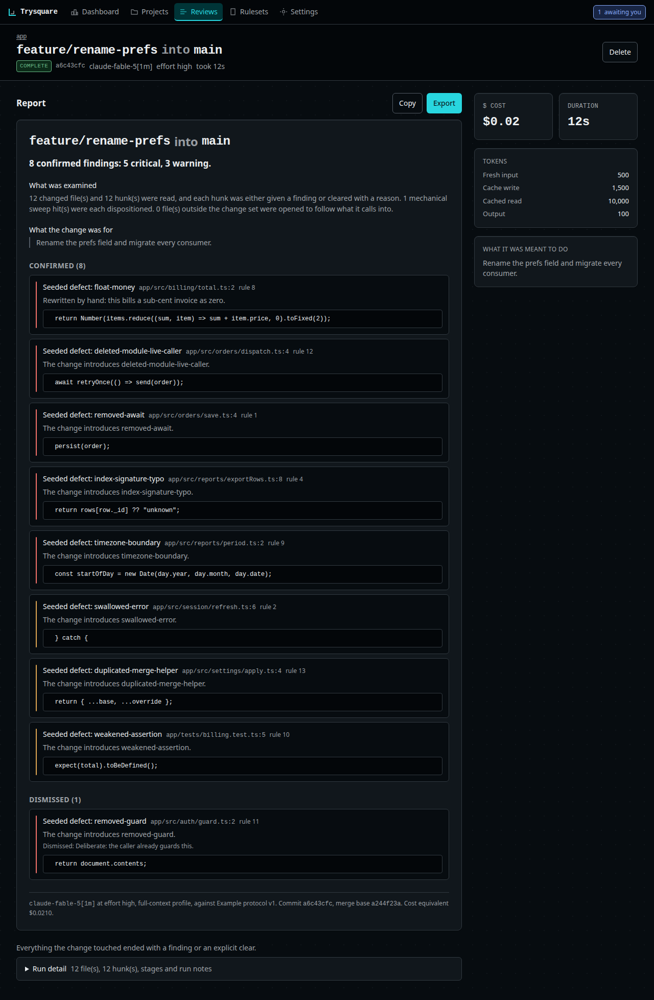

# Trysquare

A local code reviewer that reads a git branch the way a careful senior engineer
would, and refuses to hand you a finding it cannot prove.

A try square is the tool a woodworker holds against a joint to find out whether
it is genuinely square, rather than merely looking square. That is the whole
idea here. An AI can produce a review that reads well and is quietly wrong: a
line number that drifted, a bug that a guard clause upstream already handles, a
quotation of code that is not there. Trysquare is built so those failures are
checked for rather than trusted away: the program holds every quotation to the
file, and a finding stands only when two independent verifiers each prove it.

## Status

**The app runs end to end, and the question it exists to answer is still
open.**

You can add a project, review one branch against another, watch the run,
decide every finding, and export a report. A browser test walks exactly that
path on every CI run, from an empty app to an exported file.

What is not settled is whether the findings are worth a person's time. Two
kinds of evidence exist, and they answer different halves of that question.
The free half: against a fixture with eleven planted defects (measured
2026-08-04) and two files that are deliberately correct, the pipeline carries
a correct review intact, finds all eleven, invents nothing in the clean
files, and discards no quotation as unverifiable. Run it yourself with
`npm run demo:fixture -- --fake`, which spends nothing. The paid half ran on
2026-08-04 on the maintainer's subscription: a haiku smoke was correctly
refused by the coverage law, the first full-strength run exposed a real
product bug that was fixed the same day, and the two runs after the fix each
found 8 of the 8 defects the fixture then planted, at the exact lines, with
nothing invented and nothing discarded, for about a dollar and five minutes
each. The fixture has since grown to eleven defects, and three paid runs
followed: on 2026-10-22 all eleven were found and verified and nine were
cited where the key cites them (9/11); on 2026-10-23, with the proof each
finding must now carry and a second verifier, all eleven were raised, eight
were proven by both verifiers and three were left as open questions (7/11);
on 2026-10-24, after the rule for where a proof must pass and the fixture's
key had both been changed, all eleven were proven by both verifiers (11/11).
Their summaries are in
[docs/GATES.md](docs/GATES.md). What no run settles is the judgment itself: whether those findings
read as worth a person's time is the maintainer's call, described in
[docs/plans/FG2-CHECKLIST.md](docs/plans/FG2-CHECKLIST.md), and it has not
been made.

All twelve work packages are built: the review engine, the data and git
layers, every screen, the design pass, the accessibility checks, and the
interactive engine mode that runs a review from files in your own terminal
instead of a subprocess. What remains of the MVP in
[docs/plans/MVP-PLAN.md](docs/plans/MVP-PLAN.md) is the maintainer's
verdict on finding quality, to be given on a fresh real run of the fixture
on Linux, and their own review of a real branch (7.4); the verdicts and the
design acceptance are theirs. The work from here to completion is
[docs/plans/COMPLETION-PLAN.md](docs/plans/COMPLETION-PLAN.md).
[docs/PROJECT-STATE.md](docs/PROJECT-STATE.md) is the current-facts cache.

From 2026-11-03 others use it too, and help improve it. Start with
[Running it](#running-it) below, and read [CONTRIBUTING.md](CONTRIBUTING.md)
before changing anything. Whether the findings are worth a person's time is
still the open question above, and every review run by someone new helps
answer it.

## The idea

Most AI review tools ask a model to look at a diff and report what it finds.
That produces two failure modes that are hard to notice: the model skips things
without telling you, and it reports things that are not true.

Trysquare is designed around the assumption that both will happen.

**Bookkeeping is code, not judgment.** Building the list of changed files and
hunks, running the mechanical pattern sweeps, tracking which hunks have been
dealt with, and checking cited line numbers are all done by the program. The
model is asked for judgment, and only judgment.

**Nothing is allowed to be silently skipped.** Every hunk, every sweep hit, and
every deletion has to end the review either attached to a finding or explicitly
cleared with a reason. A review cannot reach the report while anything is
undispositioned. This is enforced by a coverage ledger in the database, not by
asking the model nicely.

**Every finding is verified by someone who did not write it.** Candidate
findings go to a second pass in a fresh session with no access to the reasoning
that produced them. Its job is to open the file, quote the actual lines, and
try to kill the finding: is the code really there, does the mechanism really
hold, is there a guard upstream that already handles it. Then the program
checks the verifier's own work, comparing the quoted code against the file
at the cited lines and forgiving only what carries no meaning, such as line
endings and the indentation a quote may have lost. A finding with a line number that does not match dies
regardless of how confident anything was about it.

**A human decides what counts.** Surviving findings are presented for you to
confirm or dismiss with a reason. Only what you confirm is reported as a
finding; what you dismiss or leave out is listed after the findings, with
your reason.

**Reviewed code is never modified.** Projects are cloned bare, reviews run in
detached worktrees pinned to a commit, and the model gets a read-only tool
allowlist. No code path writes a project's code, in its clone or in a
review's checkout. Git alone writes in a clone: a fetch brings its branches
to the remote's, and a review registers its worktree there.

## What it looks like


The home is a board of widgets ordered by what it costs you to miss: anything
waiting on a person sits above anything that merely happened. Every number on
it is counted from runs on this machine, and a rate with nothing judged yet
renders as a dash rather than as a confident zero.


The three screenshots are of the seeded test fixture, whose defects are
planted on purpose and whose findings say so. They are the browser suite's own
screenshots, copied here by hand rather than staged for the README: the
dashboard on 2026-11-20, the other two on 2026-10-25. The suite takes them
again on every CI run, so a copy here can fall
behind the screens. What they show is the fake engine's scripted review. The
real-model smoke runs described in Status happened locally and their evidence,
including every finding's text, was kept under `review/`, which is
deliberately not committed, on machines the maintainer no longer has. What
remains of each run is its summary in [docs/GATES.md](docs/GATES.md). No real model has reviewed a real project through this app yet:
that is the next gate, and it is the maintainer's to drive.

A finished review leads with how its findings were proven and the five steps
it was read in, then the queue (on a phone the queue comes first while
findings wait to be decided), and the run's own account of itself folds away
behind Run detail. The panel worth opening there is Coverage: it says how many
files, hunks and sweep hits were accounted for, which is what separates
"nothing is wrong" from "nothing was looked at". Its stage timeline shows the
two ends, Prepare and Audit, with no tokens or cost, because those are the
deterministic halves that no model touches.



Both themes are first-class and both are photographed and checked for contrast
on every CI run.

## How it works

You add a project by git URL and it is cloned locally. You pick the branch to
review, the branch to compare against, one ruleset, a model, and how hard the
model should think. You can add a sentence saying what the change was meant to
do, which is treated as a claim to check rather than as an instruction. Before
anything is spent, a pre-flight tells you what would be examined: the commits
it would pin, the file and hunk counts, the sweep hits, and how many model
requests it expects to make.

Rulesets are imported by pasting a markdown protocol document, which becomes
numbered rules and process directives; the import is refused if it produces no
rules. A ruleset can also be started with no document and its rules written in
the app. On a ruleset's page a rule is switched off, given another severity,
edited as the markdown it is, added or removed, and the ruleset exports as a
document that imports back as what is stored. Process directives come only
with an imported document. A review keeps the rules it started with, so a
later change never alters a past review. Each ruleset carries a tier, meaning
rules for any code, rules for a technology, or rules for one project. Choosing
several rulesets so the tiers compose in one review is designed but not built:
today a review uses one.

The review then runs as a sequence of stages, mirroring a rigorous manual
review: build the change inventory, classify risk, understand the code
including the files it calls into, hunt adversarially against the rule
database, review deletions as first-class changes, verify every candidate
finding, and audit coverage before producing anything.

Two details worth knowing. Reviews can span two repositories at once, for the
common case where an app and a package it consumes are changed together and a
type change in the package is only dangerous at the consumer. And the way work
is divided between requests adapts to the model you pick, because a model with
a large context window can hold an entire rule set at once and a smaller one
cannot. What never adapts is that nothing goes unchecked without a record:
every pairing of a rule and a changed file is either checked or recorded as
deliberately left out, and the app proves that on the planned requests
before it sends one. Only the `decomposed` profile, the one mid-tier models
get, leaves any out: a rule is not sent for a file whose path suggests none
of the rule's themes. The pre-flight says how many such pairs there are, and a
note on the run names the first twenty. A rule's text is never shortened.

A project can also have its own checks turned on. Its install, tests and e2e
then run as you, on a throwaway copy of the branch, before any model is asked,
and a command that fails is a finding the app proves from its exit code and
output. The screenshots the e2e saves in the folder named for them, up to 200,
are graded A to D by the review's model, against the project's design standard
when it names one; one graded C or D is graded again by a second model (Fable
5.1 for an Opus review, Opus 5.5 otherwise), and both must fail it for it to
stand. In the default mode the app watches each grading session and refuses a
grade of a screenshot the session never asked to read. In the interactive mode,
where a review runs in your own terminal, nothing is watched, so there the
grader's word that
it opened each image stands alone. A project with no e2e is reported as
"design not checked", never given a grade.

## Requirements

- Linux or macOS. Every push to `main` and every pull request runs the
  whole test suite on both in CI
  (GitHub's `ubuntu-latest` and `macos-latest`) against a stand-in for the
  CLI, and a pull request merges into `main` only with both green (the
  maintainer's own pushes are exempt, D-232). Real reviews have
  run on Linux; macOS has had none. Linux comes first for now (D-245,
  2026-11-19): a failure only the macOS job shows is recorded and parked
  until the work on Linux is done.
- Windows is not looked after for now (D-232, 2026-11-17): nobody who works
  on Trysquare uses it. The app was built to run there and ran real reviews
  there on 2026-10-22, and CI still runs the suite on `windows-latest`
  beside them, but that job gates nothing, and a failure only it shows is
  recorded and left (one was fixed on 2026-11-18, before that was settled).
  Its runner sometimes refuses a browser test's
  connection with `net::ERR_NO_BUFFER_SPACE` before the app answers
  (D-105). If you need Windows, open an issue. Set `TRYSQUARE_CLAUDE_PATH`
  to `claude.exe` or an npm `claude.cmd` when using a CLI other than the one
  installed with the app.
- Node 22 or newer
- git
- A Claude subscription, signed in to [Claude Code](https://claude.com/claude-code)
- Claude Code 2.1.301 or newer; reviews refuse an older CLI and say so.

`npm install` installs the Claude Code CLI with the app (version 2.1.301,
about 500MB on Linux as measured on 2026-11-17, where npm brings two builds
of it), so there is nothing else to install. Reviews
run through that local CLI: the app holds no API key and calls no API of
its own. The CLI uses the sign-in kept in your home directory's `.claude`
folder, the same one Claude Code uses elsewhere on the machine: signed in
there, Trysquare is signed in too. To sign in, or
to check, run the CLI the reviews use:

```bash
npm run claude:auth
```

That checks the CLI is version 2.1.301 or newer, and signs you in only if
there is no sign-in yet. It exits 0 when reviews can run. It acts on the CLI
installed with the app, or the one `TRYSQUARE_CLAUDE_PATH` names; a CLI path
you keep on Settings is not read by these commands, and Settings names the
command that signs that one in. The commands it
wraps are still there if you want one step at a time:

```bash
npm run claude -- auth login
npm run claude -- auth status
```

Or press Check the CLI on Settings, which names the CLI reviews run
through, its version, and whether a review draws on the subscription or
bills per token.

Trysquare drives that CLI using whatever credentials it already holds. It
ships no model of its own and has no account system, no server of its own,
and sends no telemetry. Two things it is built on would send their own, and
both are switched off. Next.js, the framework, would record anonymous usage
from `next dev` and `next build`; `next.config.ts` turns that off. The
Claude Code CLI sends usage telemetry and error reports by default; every
CLI the app starts is told to make only the requests a review needs,
whatever your shell says. A CLI it does not start is yours: in the
interactive mode you run each stage yourself, and for a CLI whose path you
keep on Settings or in `TRYSQUARE_CLAUDE_PATH` the app prints the sign-in
command for you to run; each runs in your own terminal and with your own
environment, your choice about the CLI's telemetry included. `npm run
claude` and `npm run claude:auth` are the app's own: with
`TRYSQUARE_CLAUDE_PATH` set in the terminal they start that CLI as the app
starts any other, its telemetry off. Two requests the framework still makes, both to the npm registry:
when the app starts with `npm run dev`, or is built from a terminal or by an
AI agent, Next.js asks whether its own installed version has a security
advisory, sends that version number to do so, and reads the list of Next.js
releases if one does; and when a browser first opens the app under
`npm run dev`, it asks which Next.js version is the latest. `npm run start`,
on a build already made, makes neither. The CLI's sign-in check is a request
of its own: the app runs `auth status` as the screens that show the sign-in
open, before a headless review is created or started, and in `npm run
doctor` (`docs/06-MODELS-AND-PROFILES.md`, section 1, lists each occasion),
and on 2.1.301, signed in on a subscription, that command asked for
`api.anthropic.com` three times behind a proxy that refused each, and still
read as signed in. What it asks there was not seen. The version check asked
for no host.

Be clear about what that does and does not mean. Reviewing code with a model
means sending code to that model: when a review runs, the diff, the contents of
the files involved, your rulesets, what you wrote the change was meant to do
and, where a project's own checks are on, the screenshots its e2e saved and
its design standard are sent to Anthropic by the Claude Code CLI, under
whatever terms and plan you already have with them. That is inherent to the
tool doing its job, not an extra. What Trysquare adds is that nothing goes
anywhere else from Trysquare's own code: no Trysquare service, no analytics,
no third party. A protocol document you import cannot change that either:
an image in it is shown as its words and its address, never fetched. The app
also runs git, to clone and fetch each project from its own remote, and
never to push. It is your git, with your own configuration (git's
system-wide file is left out, bar the credential helpers it names): a
credential helper you set up runs as it does for you. Git LFS is switched off for the checkout
a review reads, so a file kept in LFS is read as its pointer and not
downloaded; the separate copy made for a project's own checks, when you turn
those on, is checked out by your git as you have it configured. Your
projects, review history, and findings are stored only in a local SQLite
database and files under your own home directory.

## Running it

On a new machine, from a clone of this repository:

1. Check Node is 22 or newer (`node --version`). `.nvmrc` names the version
   this is built on.
2. Install the dependencies. This also installs the Claude Code CLI:
   ```bash
   npm install
   ```
3. Sign the CLI in with your own Claude subscription. Run it once per
   machine, and again only if the check says you are signed out:
   ```bash
   npm run claude:auth
   ```
4. Start the app and open <http://localhost:3000>:
   ```bash
   npm run dev
   ```
   Before the app starts, `npm run dev` runs `npm run doctor`, which checks
   Node, git, the SQLite driver, the CLI and its sign-in (the installed CLI
   or the one `TRYSQUARE_CLAUDE_PATH` names, not a path kept on Settings),
   the data directory and whether any ruleset is stored. A failed check
   stops the start and says
   what to fix. A WARN line lets the app start, but reviews need it: most
   often the sign-in (step 3) or a ruleset (below).
5. Check the project still passes its own gate, which needs no sign-in:
   ```bash
   ./verify.sh
   ```

Each step is repeatable. Step 5 is the test run: it ends with exit 0 when
everything passes, and that exit code is the only result to rely on.

There is no database to install. The app keeps its data in a SQLite file under
the data directory, which it creates and upgrades itself on first start. The
one native part is the SQLite driver, which `npm install` fetches for your
platform. Run `npm run doctor` on its own if that step fails.

### Seeding your company's rules

A fresh install has no rulesets, and a review is judged against one. Import
the protocol on the Rulesets screen by pasting it, start a ruleset there with
no document and write its rules in the app, or seed the protocol from a file:

```bash
npm run rules:seed -- /path/to/REVIEW_PROTOCOL.md --name "Company base rules"
```

`--tier` is `global` by default, for rules that apply to any code; `tech` and
`project` are the other two. Add `--replace` to replace a ruleset of that name
whose rules differ. A file that has no rules, or has lines the importer cannot
place, is refused, and the reason is printed. Running it again with the same
file changes nothing. Stop the app first: the seed takes the same lock the app
holds, and refuses while it is running.

The seed reads the file where it is and does not copy it into this repository.
Keep company rules outside the repository, or in `docs/private/`, which is
ignored by git.

`npm run dev` serves the app on <http://localhost:3000>, on this machine
only: it and `npm run start` bind to 127.0.0.1, so nothing else on the
network can reach it. It
opens on the dashboard. [docs/RUNBOOK.md](docs/RUNBOOK.md) walks through a first review from
there, including which actions spend model usage and which do not.

To see the whole pipeline work without spending anything and without a model:

```bash
npm run demo:fixture -- --fake
```

That builds two small git repositories with known defects planted in them,
reviews them end to end, and scores the result against the answer key. Ask
for `-- --real` instead and it runs against a real model on your
subscription; told neither, it says how to run it and spends nothing.

Two environment variables matter. `TRYSQUARE_DATA` is the data root, holding
`db.sqlite`, `projects/`, `runs/` and `exports/`, and defaults to
`~/.local/share/trysquare`. `TRYSQUARE_CLAUDE_PATH` is the binary reviews run
through; unset, it is the CLI path kept on Settings, then the CLI installed
with the app, then `claude` on your PATH.

## Development

```bash
./verify.sh              # the gate: lint, format, types, house style,
                         # private-material, hidden-file and dead-export
                         # checks, unit tests
./verify.sh --build      # adds a production build
./verify.sh --e2e        # adds end-to-end tests (needs chromium, below)
```

The end-to-end run needs a browser, once per machine:

```bash
npx playwright install chromium
```

"Verified" in this project means exactly one thing: `./verify.sh` exited zero.
The script checks each step's exit status separately from its output and also
scans that output for runtime error markers, because a step that prints a stack
trace and still exits zero is a failure. A step that hangs is a failure too,
not something to wait out.

The gate's own failure paths have been deliberately triggered and observed to
fire. A gate that has never failed is assumed broken until proven otherwise,
and the first version of this one did in fact pass a violation it should have
caught.

The test runs are sized so they cannot take a laptop down. The unit tests use
at most 4 workers, however many cores the machine has, and each worker stops
at a 1 GB heap. Measured on 2026-11-03 on Linux with 3 workers: 0.8 GB at the
peak for the whole run, and 64 seconds. The browser tests run one at a time
against one server. Run one gate at a time: two at once share the machine and
the browser tests' port.

## Options under discussion

Not built, and not decided: these are open for the team to weigh.

- **Reviews in a GitHub pipeline.** A pull request would start a workflow
  that installs Trysquare, reviews the branch against its base, and posts
  what it found. A whole review already runs from a script with no screens
  (`npm run demo:fixture`), and the CLI already takes a sign-in token from
  `CLAUDE_CODE_OAUTH_TOKEN`. Still open: a review command for any
  repository, what a pipeline may send when only a person can confirm a
  finding, a token with write access to post results, what each run costs,
  and whether a subscription token may be used unattended.

## Documentation

The design is written down before it is built, and the documents are kept
current rather than written once.

| Document | What it covers |
| --- | --- |
| [docs/00-BRIEF.md](docs/00-BRIEF.md) | What the app is meant to be |
| [docs/01-ARCHITECTURE.md](docs/01-ARCHITECTURE.md) | Topology, layering rules, on-disk layout, engine adapter |
| [docs/02-DATA-MODEL.md](docs/02-DATA-MODEL.md) | Schema, state machines, coverage invariants |
| [docs/03-REVIEW-PIPELINE.md](docs/03-REVIEW-PIPELINE.md) | The review stages and what is code versus judgment |
| [docs/04-UI-DESIGN.md](docs/04-UI-DESIGN.md) | Screens, states, accessibility |
| [docs/05-TESTING.md](docs/05-TESTING.md) | Test strategy and the seeded-bug quality gate |
| [docs/06-MODELS-AND-PROFILES.md](docs/06-MODELS-AND-PROFILES.md) | Model discovery and how the pipeline adapts to model capability |
| [docs/RUNBOOK.md](docs/RUNBOOK.md) | Install, start, and run a first review |
| [docs/PROJECT-STATE.md](docs/PROJECT-STATE.md) | What is actually built right now |
| [docs/plans/BUILD-PLAN.md](docs/plans/BUILD-PLAN.md) | Work packages and milestones |
| [docs/plans/COMPLETION-PLAN.md](docs/plans/COMPLETION-PLAN.md) | The remaining work, item by item, with the decisions that are the maintainer's |

That is the short list. [docs/README.md](docs/README.md) indexes every
document, including the decision log and the gate ledger, and is the map to
read first if you are picking the work up rather than picking it out.

## Contributing

Contributions are welcome. [CONTRIBUTING.md](CONTRIBUTING.md) explains how the
work is organised and what a change needs before it can be merged. The short
version: keep changes small, make `./verify.sh` pass, and show evidence that
what you claim works actually works.

## Licence

[MIT](LICENSE).

## Not affiliated with Anthropic

This is an independent project. It is not made by, endorsed by, or affiliated
with Anthropic. It runs the Claude Code CLI on your own machine under whatever
plan you already have, and "Claude" and "Anthropic" are trademarks of Anthropic
PBC, used here only to say what the tool talks to.
